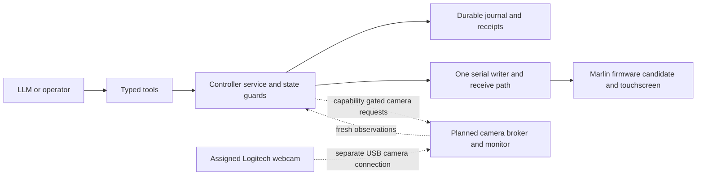

# Controller architecture and repository relationships

The host has one codebase. Its virtual printer tests and Model Context Protocol
interface run on the controller computer. Operating-system differences belong
in discovery, serial ownership/I/O and camera backends. They do not require a
Mac-specific or Linux-specific firmware image. Firmware selection depends on
the printer board/processor, screen and bootloader.

The host repository contains the tool service, journal, assignment gates,
simulators, native test harnesses, read-only Mac discovery, Linux descriptor I/O
and camera/mount design. The firmware fork contains changes to the pinned
Creality/Marlin controller source. A separately prepared focused Marlin fix is
intended for upstream review. No OctoPrint upstream submission is made because
its contribution rules exclude this generated adapter; installed OctoPrint is
used as a dependency with preserved attribution.

Linux/Python 3.11.13 passed the complete installed-package suite (876 tests,
zero skips) at the recorded snapshot. Those tests include native firmware
functions with hardware substitutes and software-terminal I/O. Mac has earlier
virtual/model demonstrations and tested read-only USB registry discovery. Mac
physical serial control remains disabled pending actual-driver qualification.
Neither operating system has a commissioned physical printer adapter here.
There are no separate published Mac and Linux forks.

The firmware candidate builds for an F401 configuration, but the development
unit's exact board, processor, screen and recovery route remain unconfirmed.
No candidate has been flashed. A tested broker exposes frames and durable numeric image controls through injected capture-owner adapters. Live acquisition/control backends and visual detection remain pending; the CAD mount is a geometrically checked prototype.

## Development identity evidence and commissioning gate

The October 26 inventory audit checked printer rows and their cell notes; no exact board, processor marking or display revision is recorded. Read-only USB metadata identifies a CH340 bridge and topology, which cannot identify the board or MCU behind it. The earlier development-only firmware response `2.0.8.28F4` is not conclusive processor identification. The F401 build remains a candidate, not permission to flash.

Commissioning requires development-unit board and processor markings, screen/About identity, matching bootloader/update procedure and a verified recovery artifact. The earlier negative nozzle reading also needs diagnosis, plus movement-clearance confirmation. None can be inferred from successful native tests. The active printer remains excluded, including if its path disappears or its job finishes; do not reset the shared hub to investigate. Independent software and documentation work does not need these physical facts.
